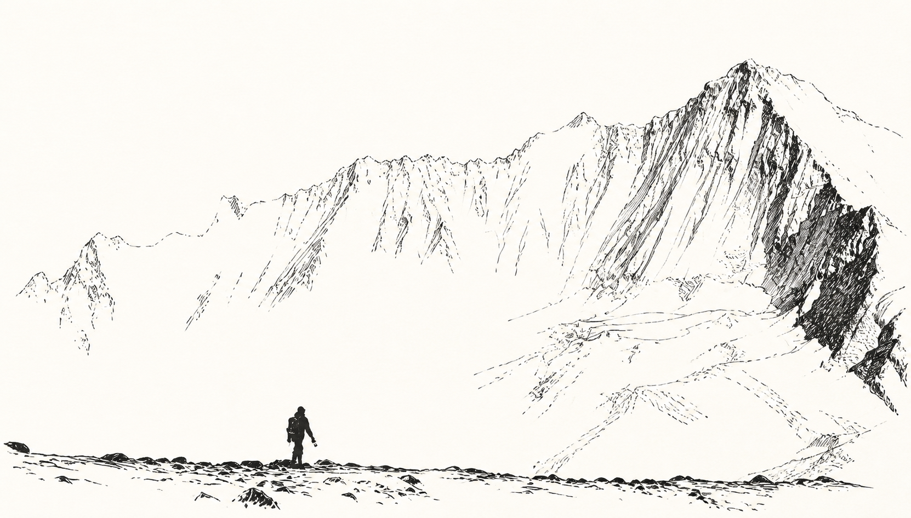

# Selective Ink Sketch｜取舍钢笔速写

把用户上传的真实照片转成有取舍、有留白、保留现场笔触的黑白钢笔速写。支持全球建筑、街巷空间、自然风景、人物动态、群像与肖像。



## 视觉原则

- 一张源照片是唯一事实来源，不机械描边，也不凭空发明结构。
- 每张图只设一个高完成度锚点，其他区域主动降为基础线、骨架或空白。
- 纯黑色钢笔线；灰度只来自可见排线疏密，不使用水彩、墨水晕染或柔和渐变。
- 保留断线、寻找线、错位重启、干涩缺口和少量修正线，避免矢量化与 AI 插画腔。
- 人物优先保证造型律动；建筑优先保证地域结构与透视；风景优先保证地貌轮廓、尺度和空气留白。

## 安装

把仓库目录复制到 Codex Skills 目录：

```bash
git clone https://github.com/joeyhu1108-maker/selective-ink-sketch.git
cp -R selective-ink-sketch ~/.codex/skills/selective-ink-sketch
```

也可以下载 [发布 ZIP](dist/selective-ink-sketch.zip) 后解压安装。

## 使用

上传一张 JPG、PNG 或 WebP 照片，然后说：

```text
使用 Selective Ink Sketch，把这张照片转成我的钢笔速写。
```

可继续补充：

- `更松，留白再多一点`
- `只刻画门楼，周围快速省略`
- `人物动态优先，破型 strong`
- `不要晕染，中间灰只用方向性排线`

## 支持模式

- `architecture`：全球建筑、街巷和空间
- `landscape`：山地、海岸、田野、森林与自然场景
- `figure`：单人动态、多人合影与服装姿态
- `portrait`：头部、半身肖像与身份特征

## 包结构

```text
selective-ink-sketch/
├── SKILL.md
├── README.md
├── README.zh-CN.md
├── agents/openai.yaml
├── assets/
├── evals/evals.json
└── references/
```

系统入口与完整工作流见 [SKILL.md](SKILL.md)，中文详细说明见 [README.zh-CN.md](README.zh-CN.md)。

黄金样例只用于理解“单一局部刻画、空白承担对象、深黑集中和线条逐级消失”的机制。运行时仍只提交用户自己的源照片，不把样例作为第二张风格参考图。
